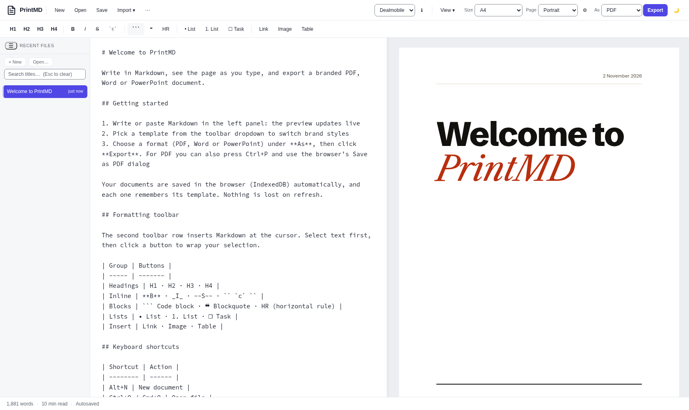

# PrintMD


A Markdown editor that exports print-quality PDF, Word and PowerPoint files, and a small PDF API you run on your own
computer. The editor is plain HTML, CSS and ES modules: no build step, no framework, nothing to install.

I built it because I wanted PDFs from my own notes that looked like someone had designed them, without opening a
word processor. It grew from there.



## Make PDFs from a script

The PDF service is an HTTP API on your own machine: send it Markdown, get a PDF back.

```bash
curl -s -X POST 'http://127.0.0.1:5787/api/v1/render?template=dealmobile' \
  -H 'Content-Type: text/markdown' --data-binary @notes.md -o notes.pdf
```

[Start the service](#the-pdf-service) first, and see [`server/README.md`](server/README.md) for every option.

## Use it from an AI agent

Two ways for an AI agent on your own machine to make PDFs with the service. Both need the service running (see
[The PDF service](#the-pdf-service)) and Node 22, and both only talk to `127.0.0.1`. A cloud agent cannot reach it.

### The skill

[`skills/printmd`](skills/printmd) is an agent skill in the open `SKILL.md` format that several coding agents read.
From this folder, link it into your coding agent's skills folder once:

```bash
ln -s "$PWD/skills/printmd" "<your agent's skills folder>/printmd"
```

Then ask in plain words, for example "make a PDF of notes.md in the Dealmobile template". The agent checks the service
is running, lists the templates, embeds your local images, writes the PDF next to the Markdown and tells you its path
and page count. If the service is not running, it shows you how to start it.

### The MCP server

[`mcp/printmd-mcp.mjs`](mcp/printmd-mcp.mjs) is a Model Context Protocol server over stdio, for MCP clients such as
desktop chat apps and coding agents. It has no dependencies, so there is nothing to install. Add it to your client's
MCP configuration, with the absolute path to your copy:

```json
{
  "mcpServers": {
    "printmd": {
      "command": "node",
      "args": ["/path/to/printmd/mcp/printmd-mcp.mjs"],
      "env": {"PRINTMD_MCP_ROOT": "/path/to/your/documents"}
    }
  }
}
```

Tools:

- `check_service`: is the service running, and the command to start it when it is not.
- `list_templates`: the templates, with the page sizes and orientations each offers.
- `render_pdf`: a Markdown file (`path`) or Markdown text (`markdown` plus `output`) to a PDF, with the same options
  as the API (template, page size, orientation, layout, fit, margin, title, author, date, subject, language, cover,
  printed links, tidy, strict). It returns the PDF's path, template, page count, warnings and notes.

It reads only `.md` and `.markdown` files and writes only `.pdf` files, and only inside one folder:
`PRINTMD_MCP_ROOT`, or when that is not set, the folder the client starts the server in. Links that lead out of that
folder are refused, and an existing PDF is replaced only when the call asks for it. Local images are embedded from the
document's own folder, as the skill does; web images are not fetched. `PRINTMD_URL` changes the service's address
(default `http://127.0.0.1:5787`), and only a local address is accepted. Before it sends anything it checks that the
health answer names the service as `printmd`, and refuses any other program on the port. The server never starts the
service itself: when it is not running, the tools say how to start it.

The service makes PDFs only, so there are no Word or PowerPoint tools; those exports are in the editor.

## Run it locally

PrintMD is made to run on your own machine. That is where you get everything:

- Documents live in your browser, never on a server.
- The PDF service renders with your own copy of Chrome, so it is fast and nothing leaves your computer.
- Files you open stay linked to the file on disk, and saves go back to it.

A hosted copy of the editor runs at <https://printmd.dealmobile.co.uk>. It works for a look around and for PDFs
through the browser's print dialog, and shows a notice saying so. **The PDF service is not available when
hosted**: it refuses to start on anything but your own machine (127.0.0.1), and that is deliberate, not a missing
feature.

## Quick start

You need a recent Chrome or Edge, and Python 3 for the one-line web server. Node 22 is only for the PDF service and
the tests.

```bash
git clone <your copy of this repository> printmd
cd printmd
python3 -m http.server 8080
```

Open <http://localhost:8080>. Opening `index.html` straight from disk does not work: browsers block ES modules on
`file://`, so serve the folder as above (any static server will do).

### The PDF service

```bash
npm --prefix server ci
npx --prefix server playwright install chromium     # or: export PRINTMD_CHROME=/usr/bin/google-chrome
npm --prefix server run start:local
```

It listens on `http://127.0.0.1:5787` and needs no sign-in, because only your machine can reach it.

```bash
curl -s http://127.0.0.1:5787/api/v1/health
curl -s -X POST 'http://127.0.0.1:5787/api/v1/render?template=dealmobile&pageSize=A4' \
  -H 'Content-Type: text/markdown' --data-binary @notes.md -o notes.pdf
```

The response is the PDF. Response headers such as `X-PrintMD-Pages` and `X-PrintMD-Warnings` say what the render
found (a missing title, an image that is too small to print well). `GET /api/v1/templates` lists the templates and the
page sizes each one offers.

On Linux, `server/service/install-service.sh` installs it as a user service that starts at login. The browser opens
for a PDF and closes again when idle, so it does not sit in memory. To start the service only on the first request
instead, put a loopback proxy such as a systemd socket in front of it and set `PRINTMD_PROXY_PORT` to the proxy's
port, so the service accepts requests addressed to that port too.

## What it does

- Live preview with the active template's styles, split or single pane, light and dark theme, and a full width
  preview (View > Full width preview) that hides everything else. The preview's pages scale to fill the pane's width
  (up to twice their size) with the same layout and line breaks as the PDF.
- Open a whole folder (Open folder in the sidebar): every `.md` and `.markdown` file in it and its subfolders is
  listed in its own section as a file browser (each subfolder a row that opens and closes, folders first), and the
  folder is watched. Files added, edited or removed outside PrintMD are added, reloaded or closed within a few seconds.
  Each section and subfolder loads closed and opens with a click, and **Close all** on its heading closes that folder's files. **Close all** at the top of the sidebar closes everything. Closing a file never touches it on disk;
  documents whose changes exist only in the browser ask first.
- Default folders (Defaults... in the sidebar, or Ctrl+K): **Save open folders as defaults** and PrintMD opens the same
  folders on every start, after a browser restart too (if the browser asks for access again, click **Reconnect** on
  each folder or **Reconnect all**). Clearing the browser's site data removes them, so **Save defaults to file...**
  keeps a small `printmd-folders.json` (folder names, their order and the open file; browsers give pages no paths), and
  **Load defaults from file...** asks you to choose each folder again. Needs a browser that can open folders (Chrome,
  Edge).
- Export to PDF, Word (`.docx`) and PowerPoint (`.pptx`) from the same Markdown.
- A PDF API: `POST /api/v1/render` on your own machine. See [Make PDFs from a script](#make-pdfs-from-a-script).
- Import from PDF, Word, HTML, EPUB and Google Drive, converted to Markdown.
- Page control: any paper size or a custom one (`100x150mm`, `1200x800px`), one continuous page, fit wide tables
  to the page, your own margin. Each document remembers its settings.
- Front matter sets the cover title, author and date, and the page options, from the top of the document.
- Code blocks with 190+ languages coloured the way an editor does.
- Extra inline syntax: `==highlight==`, `~sub~`, `^sup^` and a short list of `:emoji:` shortcodes, with Pandoc's
  spacing rules so ordinary prose is left alone.
- Definition lists: a term on its own line, then lines that start with a colon and a space. They print with the term
  in bold and the definitions indented, and export to Word the same way.
- Footnotes: `[^1]` in the text and `[^1]: The note` anywhere in the document. They are numbered in order, the notes
  are one list after the last block, and each note links back to the text.
- Documents are saved in the browser (IndexedDB), with a crash buffer, a file on disk kept in sync, and a command
  palette on `Ctrl+K`.
- Print quality is checked by the tests: embedded fonts, exact page size, no headings stranded at the foot of a
  page, tables that repeat their header row.

## Templates

| Template | What it is |
|---|---|
| `unbranded` | A classic, quiet document. The default. |
| `dealmobile` | A magazine article: heavy grotesque headlines over a Caslon text face, one red accent, a running head and foot, no logo. |

Each template is one file, `templates/<id>/template.js`: a manifest, a block of CSS scoped to `.template-<id>`, and
a few render functions. List it in `templates/manifest.core.json` and it shows up in the picker and in the PDF
service's template list. `js/templates.js` documents the contract, and `templates/unbranded/template.js` is the
smallest working example. Fonts must be vendored under `vendor/fonts/` (the strict content security policy only loads
fonts from the app itself); `js/fonts.js` lists what is there.

## Tests

```bash
node tests/run-all.mjs            # everything: unit tests, browser tests, PDF checks
node tests/run-all.mjs unit       # the fast unit tests only
```

The browser tests need Chrome. The PDF checks use `pdfinfo`, `pdftotext` and `pdffonts` from poppler if they are on
your path. `docs/MANUAL-TESTS.md` lists what only a person can check.

## Product page and posts

`site/index.html` is a single-file product page you can host anywhere; it is not part of the app. The posts about
PrintMD are on [dealmobile.co.uk](https://www.dealmobile.co.uk/projects/printmd).

## Licence

MIT, see [LICENSE](LICENSE). Fonts and libraries under `vendor/` keep their own licences (SIL OFL for the fonts), and
each folder includes the licence text that came with it.
