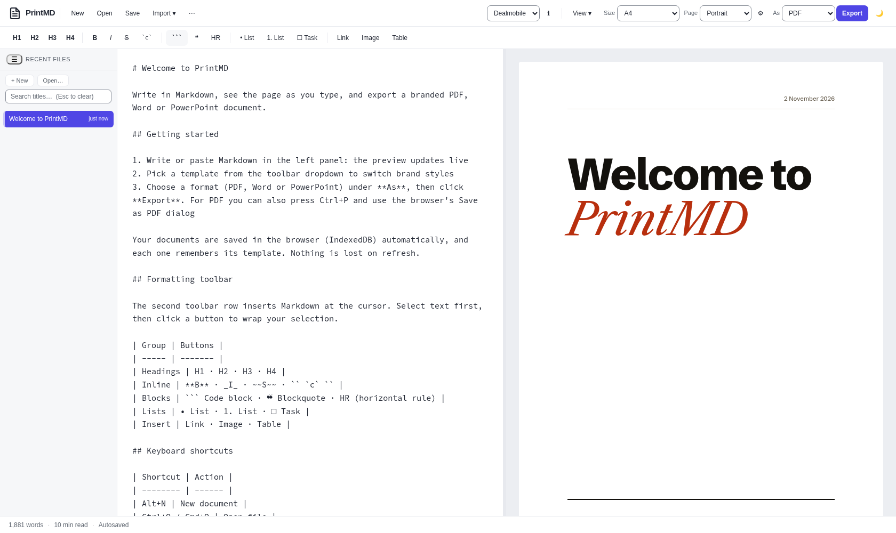

# PrintMD


A Markdown editor that exports print-quality PDF, Word and PowerPoint files, and a small PDF API you run on your own
computer. Claude Code can use that API through a skill that comes with this repository, so "make a PDF of notes.md" is
one sentence. The editor is plain HTML, CSS and ES modules: no build step, no framework, nothing to install.

I built it because I wanted PDFs from my own notes that looked like someone had designed them, without opening a
word processor. It grew from there.



## Make PDFs from Claude Code, or from a script

The PDF service is an HTTP API on your own machine: send it Markdown, get a PDF back.

```bash
curl -s -X POST 'http://127.0.0.1:8787/api/v1/render?template=dealmobile' \
  -H 'Content-Type: text/markdown' --data-binary @notes.md -o notes.pdf
```

A Claude Code skill for it lives in [`skills/printmd`](skills/printmd). From this folder, install it once:

```bash
mkdir -p ~/.claude/skills && ln -s "$PWD/skills/printmd" ~/.claude/skills/printmd
```

Then ask in plain words, for example "make a PDF of notes.md in the Dealmobile template". Claude checks that the
service is running, lists the templates, embeds your local images, writes the PDF next to the Markdown and tells you
its path and page count. If the service is not running, it shows you how to start it. It needs Claude Code on your own
machine, because the service only runs there. [Start the service](#the-pdf-service) first, and see
[`server/README.md`](server/README.md) for every option.

## Run it locally

PrintMD is made to run on your own machine. That is where you get everything:

- Documents live in your browser, never on a server.
- The PDF service renders with your own copy of Chrome, so it is fast and nothing leaves your computer.
- Files you open stay linked to the file on disk, and saves go back to it.

A hosted copy of the editor works for a look around and for PDFs through the browser's print dialog. It shows a
notice saying so. **The PDF service is not available when hosted**: it refuses to start on anything but your own
machine (127.0.0.1), and that is deliberate, not a missing feature.

## Quick start

You need a recent Chrome or Edge, and Python 3 for the one-line web server. Node 22 is only for the PDF service, the
Claude Code skill and the tests.

```bash
git clone <your copy of this repository> printmd
cd printmd
python3 -m http.server 8080
```

Open <http://localhost:8080>. Opening `index.html` straight from disk does not work: browsers block ES modules on
`file://`, so serve the folder as above (any static server will do).

### The PDF service

```bash
npm --prefix server ci
npx --prefix server playwright install chromium     # or: export PRINTMD_CHROME=/usr/bin/google-chrome
npm --prefix server run start:local
```

It listens on `http://127.0.0.1:8787` and needs no sign-in, because only your machine can reach it.

```bash
curl -s http://127.0.0.1:8787/api/v1/health
curl -s -X POST 'http://127.0.0.1:8787/api/v1/render?template=dealmobile&pageSize=A4' \
  -H 'Content-Type: text/markdown' --data-binary @notes.md -o notes.pdf
```

The response is the PDF. Response headers such as `X-PrintMD-Pages` and `X-PrintMD-Warnings` say what the render
found (a missing title, an image that is too small to print well). `GET /api/v1/templates` lists the templates and the
page sizes each one offers.

On Linux, `server/service/install-service.sh` installs it as a user service that starts at login. The browser opens
for a PDF and closes again when idle, so it does not sit in memory.

## What it does

- **Live preview** with the active template's styles, split or single pane, light and dark theme.
- **Export** to PDF, Word (`.docx`) and PowerPoint (`.pptx`) from the same Markdown.
- **A PDF API and a Claude Code skill**: `POST /api/v1/render` on your own machine, or ask Claude Code in plain words.
  See [Make PDFs from Claude Code, or from a script](#make-pdfs-from-claude-code-or-from-a-script).
- **Import** from PDF, Word, HTML, EPUB and Google Drive, converted to Markdown.
- **Page control**: any paper size or a custom one (`100x150mm`, `1200x800px`), one continuous page, fit wide tables
  to the page, your own margin. Each document remembers its settings.
- **Front matter** sets the cover title, author and date, and the page options, from the top of the document.
- **Code blocks** with 190+ languages coloured the way an editor does.
- **Extra inline syntax**: `==highlight==`, `~sub~`, `^sup^` and a short list of `:emoji:` shortcodes, with Pandoc's
  spacing rules so ordinary prose is left alone.
- **Definition lists**: a term on its own line, then lines that start with a colon and a space. They print with the term
  in bold and the definitions indented, and export to Word the same way.
- **Footnotes**: `[^1]` in the text and `[^1]: The note` anywhere in the document. They are numbered in order, the notes
  are one list after the last block, and each note links back to the text.
- **Documents** are saved in the browser (IndexedDB), with a crash buffer, a file on disk kept in sync, and a command
  palette on `Ctrl+K`.
- **Print quality** is checked by the tests: embedded fonts, exact page size, no headings stranded at the foot of a
  page, tables that repeat their header row.

## Templates

| Template | What it is |
|---|---|
| `unbranded` | A classic, quiet document. The default. |
| `dealmobile` | A magazine article: heavy grotesque headlines over a Caslon text face, one red accent, a running head and foot, no logo. |

Each template is one file, `templates/<id>/template.js`: a manifest, a block of CSS scoped to `.template-<id>`, and
a few render functions. List it in `templates/manifest.core.json` and it shows up in the picker and in the PDF
service's template list. `js/templates.js` documents the contract, and `templates/unbranded/template.js` is the
smallest working example. Fonts must be vendored under `vendor/fonts/` (the strict content security policy only loads
fonts from the app itself); `js/fonts.js` lists what is there.

## Tests

```bash
node tests/run-all.mjs            # everything: unit tests, browser tests, PDF checks
node tests/run-all.mjs unit       # the fast unit tests only
```

The browser tests need Chrome. The PDF checks use `pdfinfo`, `pdftotext` and `pdffonts` from poppler if they are on
your path. `docs/MANUAL-TESTS.md` lists what only a person can check.

## Blog and product page

`site/index.html` is a single-file product page and `blog/` holds the posts that go with it. Both are plain files
you can host anywhere; neither is part of the app.

## Licence

MIT, see [LICENSE](LICENSE). Fonts and libraries under `vendor/` keep their own licences (SIL OFL for the fonts), and
each folder includes the licence text that came with it.
