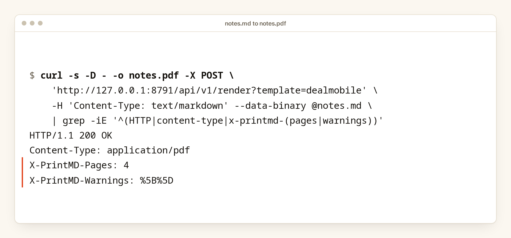
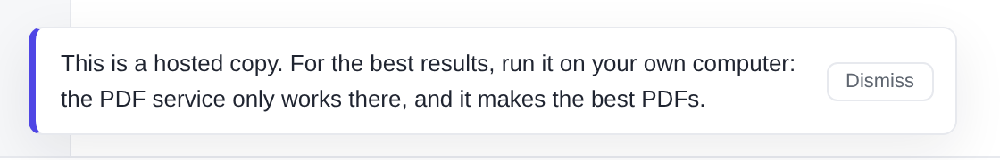

# A PDF service that only runs on your machine

I call [PrintMD](../README.md)'s PDF service from scripts, because one command is quicker than opening an editor. It turns Markdown into a PDF with one request, and it refuses to run anywhere but your own computer. That keeps a tool for making good PDFs out of the business of defending a public rendering service.

## A browser that prints

The service drives a browser through Playwright and prints with it. The request is the Markdown and a few options: template, page size, layout, margin. The answer is the PDF, with headers that report the page count and any warnings about the document.

By default that's the Chromium Playwright downloads; set `PRINTMD_CHROME` and it uses your own Chrome instead. Left to itself, the browser stays open between renders. On Linux, the user service that `server/service/install-service.sh` installs closes it a minute after the last render, so an idle service holds no browser open.

## Why it won't be hosted

A service that turns any text it's sent into a rendered page, on a machine with a network, is a place where things go wrong. Someone sends a document that asks the browser to fetch an internal address, or to burn minutes of CPU, or to render a page the size of a billboard. Every one of those is something I'd have to defend against, forever, for a tool whose job is to make nice PDFs.

On your own machine most of those questions go away, because the only person sending documents is you. The service has one mode, local. It listens on 127.0.0.1, or another loopback address, and won't start if you point it at anything else, or ask it to run behind a token or a login.

## It's still locked down

Even on your own machine, a Markdown file can contain images and links, and you might paste in something you didn't write. The render page is closed off against that:

- It can only load files that belong to the app. A request for anything else is blocked and listed in the response's warnings header.
- The print page has a content security policy with scripts, frames and connections switched off.
- The Markdown can be up to 2 MB, not counting embedded images, a request up to 15 MB and one image up to 5 MB, and a render gets 20 seconds.
- It renders two documents at a time with a short queue, and answers "busy" to the rest.

## The editor

The editor is a different case. It's a static page, and nothing in it sends your documents anywhere, so hosting it is fine. When it's hosted it says so:

The editor makes its PDFs through the browser's print dialog, hosted or not. The service is the other way to make one, and that only runs on your own computer.
