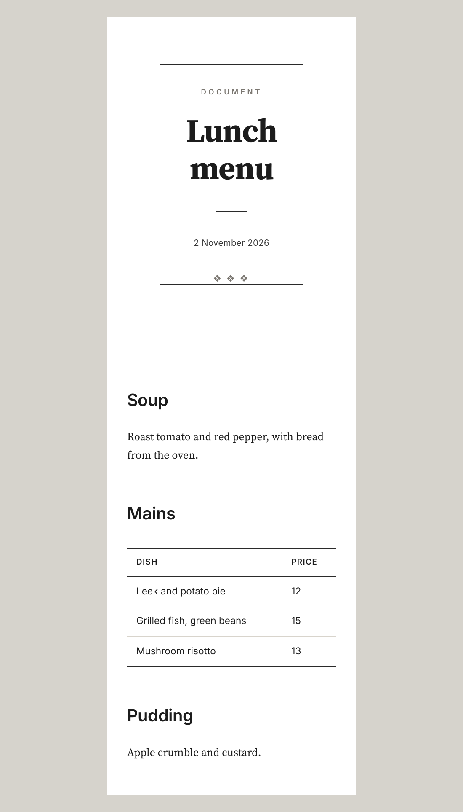

# Custom sizes, one long page and fit to width

A page in [PrintMD](../README.md) can be any size from 30 mm to 5,080 mm a side. It can also be one continuous page, exactly as tall as the content, which suits a one-page menu, a slide or a long receipt.

## Any size, within hard limits

A size is one value, such as `100x150mm`, `8.5x11in` or `1200x800px`, where a pixel is the CSS pixel, a 96th of an inch, so 1200 by 800 pixels is 317.5 by 211.7 millimetres. In the page options the width, height and unit (millimetres, centimetres, inches or pixels) are set separately. The limits are fixed. The longest side allowed, 5,080 mm, is 200 inches, and no page can be bigger than four square metres. A tiny page with a long document could otherwise make thousands of pages, so the PDF service refuses a custom size that would print more than 5,000, and the editor warns before it prints one.

## One continuous page

The continuous layout puts the whole document on a single page of the chosen width, as tall as the content, with no page breaks and no running head or foot.



The page is laid out first, measured once the fonts and images have loaded, then printed at that height. A document taller than one PDF page can be is split into a few tall pages, with a heading kept with what follows it, and a note says so. The PDF service refuses a document that would run past 50.8 metres.

## Fit to width

Fit width scales a wide table or image down to the column and says what it did: "Table 1 is scaled to 72% to fit the page width." I'd rather leave a block at full size with a warning than shrink it below 40%, where the text gets too small to read. On a continuous page there is one more choice, Widest block, which widens the page to fit its widest table or image.

## Margins

An empty margin uses the template's. Otherwise it's a number in millimetres, centimetres, inches or points, up to about 100 mm, but the page always keeps at least 20 mm across for the text: the editor won't save a margin that leaves less, the PDF service answers one with an error, and a margin from front matter is reduced to fit, with a note. In the Dealmobile template the running head and foot need a margin of 18 mm or more, so under that they're left out, with a note.

The same options can sit in the document's front matter, and then the file carries its own page. The editor reads the layout, fit and margin from it, and the PDF service reads the page size as well:

```markdown
---
title: Lunch menu
page-size: 100x210mm
layout: continuous
fit: width
margin: 8mm
---
```

Anything saved in the page options wins over the front matter, one setting at a time. The editor takes the page size from its Size menu, so `page-size` is only read by the PDF service, and there a value in the request wins over the front matter.
