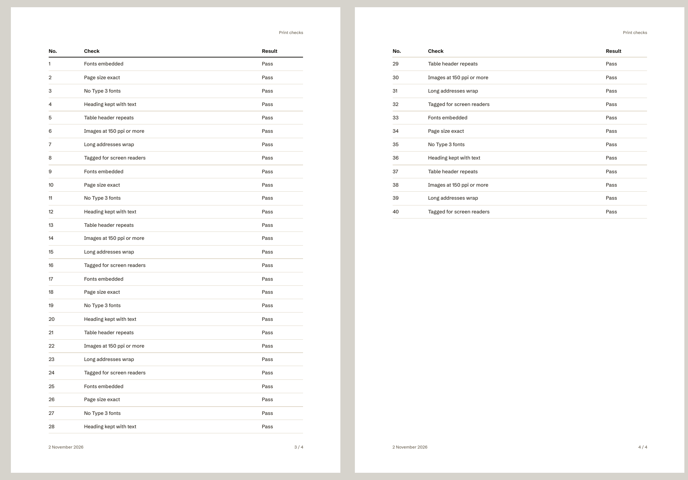

# Print-quality PDFs from a browser

A PDF that looks as if someone designed it needs fonts that travel with the file, page breaks in sensible places and images that print sharp. I wanted that for my own notes, and [PrintMD](../README.md) is where the rules live.

## Start with the fonts

If a PDF names a font the reader doesn't have, their viewer swaps in another one and your layout moves. Embedding the font in the file fixes that, and for that it has to be a real file the page can load, not a name in a stylesheet.

PrintMD bundles its fonts, all under the SIL Open Font Licence, and loads them from the app itself. Before printing, every bundled face the text uses is loaded and checked. If one didn't load, you're told which one.

Bold and italic need real faces too. When a family has no bold, the browser makes one up and prints it as a Type 3 font. The tests reject any Type 3 font in a printed PDF, and check that every family declares its italics for every weight.

## Where the pages break

Most of what makes a PDF look careless is where the pages break. A few rules cover most of it. They're requests the browser keeps wherever it can, so a table row taller than a whole page still has to break:

- A heading isn't left at the foot of a page.
- At least three lines of a paragraph stay on either side of a page break.
- A table row, a figure and a short code block stay whole.
- A table that runs onto the next page repeats its header row.
- An image is never taller than the text column.
- Long web addresses and hashes wrap at the edge of the column.

They're ordinary CSS print rules. What PrintMD adds is that every template applies all of them.

## Effects that turn into pictures

The browser draws a blurred shadow as a picture, so a decorative card with a soft shadow becomes images inside the PDF, and the file grows. Blur filters do the same. A shadow with no blur, or a see-through fill, stays as vector shapes. The templates avoid blurs and filters for that reason.

## Images are left as they are

PrintMD doesn't resize or redraw images: a 6,000-pixel-wide PNG goes into the PDF at 6,000 pixels. It does work out the resolution each one will print at, and lists any under 150 pixels per inch, because that's where print starts to look soft. SVG is vector, and prints sharp at any size.

## What the tests check

The tests render a sample document of three or four pages through the PDF service in every template, with and without a cover, and read each PDF back with the poppler tools. They check the page size, embedded fonts, images, tags for screen readers, title, language and bookmarks. They also count the images in each sample PDF, and fail if there are more than the document holds. Every check is also run against PDFs made bad on purpose, to show it catches its fault.
