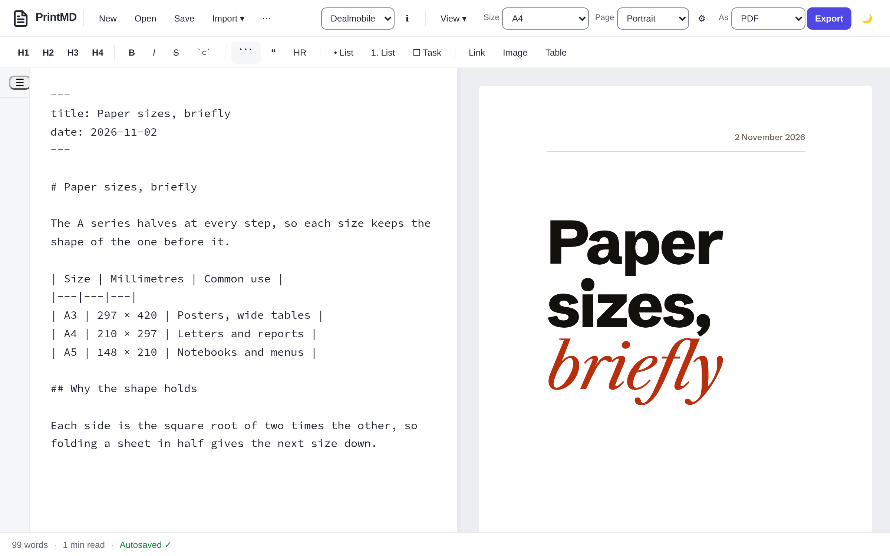

# Why I built PrintMD

I write in Markdown. Notes, plans, short reports, the odd longer document. Plain text is quick and it diffs well. The trouble starts when someone else has to read it.

Most of the time that means a PDF, and getting from Markdown to a PDF that doesn't look like a text file with a margin is more work than it sounds. Pasting into a word processor loses the structure. A browser's print dialog gets most of the way, then splits a table across two pages or leaves a heading alone at the foot of a page. The command-line tools are powerful, and many of them want a pile of packages and a LaTeX installation.

I wanted one thing: write Markdown, see the page, press a button, and get a PDF I wouldn't be embarrassed to send. That became [PrintMD](../README.md).

## What it is

PrintMD is a Markdown editor with a live preview and two templates. The preview shows the page in the template's own type and spacing, so it's close to what you'll print; page breaks and the running head and foot only appear in the PDF. Export gives you a PDF, a Word file or a PowerPoint file from the same text.

It's plain HTML, CSS and JavaScript modules. There's no build step and no framework. If you can serve a folder, you can run it. That keeps the whole thing small enough for one person to read and change.

## Where the work went

Most of the work went into making the PDFs right rather than nearly right:

- Fonts are bundled with the app and embedded in the PDF, which then doesn't depend on what the reader has installed.
- Page breaks follow a few simple rules: a heading stays with the text after it, a table row stays whole where it fits on a page, and a table that runs on repeats its header.
- Page size is a choice for each document, including a custom size, and so is a single long page for things that aren't really pages.
- A small service on my own computer turns a Markdown file into a PDF with one command, which is how I use it from scripts.

Each of those has its own post: [print-quality PDFs from a browser](print-quality-pdfs-from-a-browser.md), [custom sizes, one long page and fit to width](page-options-custom-size-continuous-fit.md), and [a PDF service that only runs on your machine](a-pdf-service-that-only-runs-on-your-machine.md).

## Why local

PrintMD is built to run on your own machine. Your documents stay in your browser. The PDF service prints with a browser on your own computer and listens only there. The editor also works [hosted](https://printmd.dealmobile.co.uk), and there it says that running it locally is better. The PDF service won't run hosted at all.

## What next

It's a tool I use, so it grows when I hit a wall. If you try it and something is awkward, the [issue tracker](https://github.com/tomgould/PrintMD/issues) is the place to say so.
